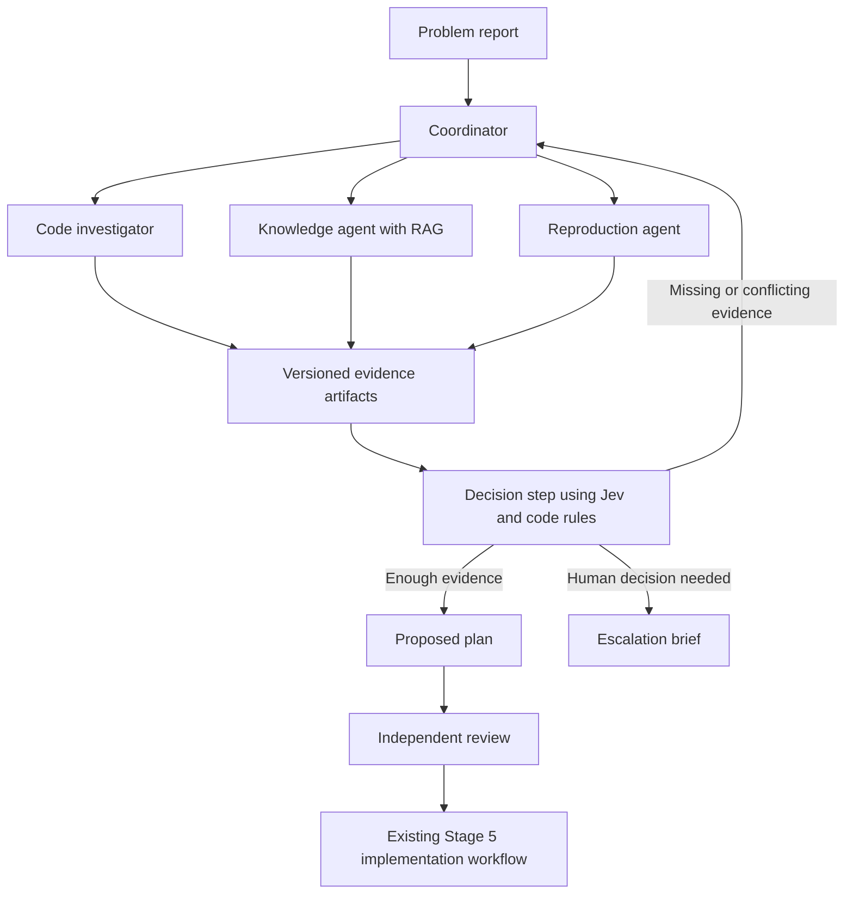
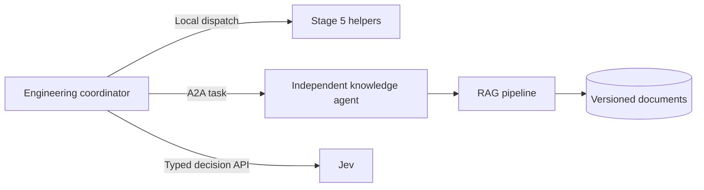

# Stage 6 proposal: Coordinated agents

**Status:** Brainstorming proposal, not an approved implementation plan.

**Context:** We currently know only the Stage 6 name, “Coordinated agents,” and the expectation of running multiple agents together. The design should be checked against the actual requirements when they become available.

## Recommended direction

Extend Stage 5 into a **coordinated engineering investigation team**: several specialists investigate a problem concurrently, retrieve relevant knowledge, compare their findings, and produce one reviewed recommendation. The existing fix workflow can execute an approved plan afterward.

This gives RAG, Jev, and A2A distinct purposes:

- **RAG:** Retrieve relevant requirements, incident history, and operational knowledge.
- **Jev:** Make narrow, typed judgments that help route work and assess evidence.
- **A2A:** Communicate with independently running agent services.
- **Stage 5 harness:** Preserve validation, review, audit, and human-decision controls.

## What makes this different from Stage 5?

Stage 5 already has multiple agents, but they mostly work sequentially. The useful next step is coordinating work that happens independently:

- Divide a problem into investigations.
- Run those investigations concurrently.
- Share evidence through explicit artifacts.
- Detect disagreements and missing information.
- Decide whether to investigate further, propose a fix, or escalate.

For example:

> After a deployment, some customers receive duplicate notifications.

A code investigator traces retries, a knowledge agent retrieves previous incidents, and a reproduction agent tries to reproduce the duplication. Each contributes different evidence.



Initially, allow parallel investigation with **one implementation worker**. Later, multiple implementers could work in separate worktrees, followed by integration and tests.

## Where RAG would help

The current sandbox is too small to demonstrate much retrieval value. Expand the knowledge around the application with requirements, architecture decisions, release notes, runbooks, and historical incidents.

The retrieval pipeline could be:

```text
Documents → split into useful sections → index text and embeddings

Question → keyword + semantic search → combine results
         → rerank → return passages with source references
```

Keyword search helps with exact function names and error messages. Semantic search helps when a report describes a problem differently from the documentation. Qdrant supports combining dense and sparse retrieval and performing retrieval in stages. [Qdrant documentation](https://qdrant.tech/documentation/search/hybrid-queries/)

Retrieval should return an **evidence bundle** containing:

- Source path and document version.
- Exact supporting passage.
- Content hash.
- Retrieval query.
- Whether the source is current or historical.

That fits the existing hash-based review system. A recommendation would depend on both the code version and the documents used to justify it.

**Retrieval finds potentially useful evidence; agents judge its relevance.** An old incident suggesting a retry bug should become a hypothesis to investigate, not an established cause.

Keep raw agent output out of the trusted knowledge collection. Promote reviewed conclusions with their provenance; retain failed attempts as explicitly labeled history.

## Where Jev fits

[Jev from TypeSafe](https://typesafe.ai/) supports typed questions such as **Choice**, **Score**, and **Noul**, with probabilities and, for Choice and Score, a confidence value. Its documentation recommends decomposing complex judgments into narrow questions and combining the answers in code. [TypeSafe introduction](https://docs.typesafe.ai/introduction)

Candidate decision points:

| Decision | Candidate use of Jev |
|---|---|
| Which specialist should investigate? | Choose among code, documentation, reproduction, or clarification. |
| Is this retrieved passage relevant? | Score relevance against a specific question. |
| Does the evidence support this particular claim? | Evaluate one claim against its cited passages. |
| What should happen next? | Choose gather-more-evidence, propose-plan, or escalate. |

Retain a reasoning model for investigation, planning, and explaining disagreements. Jev could handle narrower judgments inside that process.

**Jev's confidence is derived from its answer distribution. A confidence of 0.9 does not itself establish 90% accuracy on these tasks.** Evaluate thresholds on project-specific labeled cases. [TypeSafe confidence documentation](https://docs.typesafe.ai/confidence)

The first experiment should run Jev alongside the current decision process, recording its recommendations without letting them control execution. Compare accuracy, abstentions, latency, and cost before assigning it control over routing.

Deterministic rules remain authoritative: a model recommendation cannot override a missing review or a recorded human requirement.

## Is A2A appropriate?

Yes, particularly for independently running agents with their own capabilities and deployment lifecycle.

A2A describes agent capabilities through **Agent Cards**, tracks work through **Tasks**, and exchanges results as **Artifacts**. It is a communication protocol; the application still owns orchestration and acceptance rules. The official documentation distinguishes it from internal sub-agent calls and from MCP's tool integration role. [A2A overview](https://a2a-protocol.org/latest/), [core concepts](https://a2a-protocol.org/latest/topics/key-concepts/)

The preferred first boundary is an independent knowledge agent:



The knowledge agent could accept a task such as:

> Find previous incidents involving duplicate delivery after retries, and identify which lessons apply to this version.

It could retrieve, assess gaps, search again, and return cited evidence. That gives it enough responsibility to justify being an agent service. A simple `search(query)` operation could remain a normal tool.

Preserve two boundaries:

- An A2A task being `completed` means the remote service finished its work. The harness still validates and reviews the result.
- A remote request for more input does not automatically authorize a human checkpoint. The application decides how that request is routed.

A2A leaves artifact-version tracking to the client, so the existing freshness checks remain valuable. [A2A task lifecycle](https://a2a-protocol.org/latest/topics/life-of-a-task/)

## What needs to evolve in the harness?

The biggest change is shared state under concurrency:

- `latest("plan")` becomes ambiguous when several investigations have plans. Artifacts need task and branch identities.
- Step numbers currently come from counting audit entries. Concurrent workers need centrally allocated IDs.
- Workers should submit results to one controlled persistence layer.
- Reviews must identify the exact task, artifact, code snapshot, and evidence bundle.
- The coordinator needs explicit rules for waiting, partial failure, cancellation, and retrying a task without repeating its side effects.

Preserve the dispatcher and guardrails while introducing that task layer. If framework-managed persistence and more elaborate execution graphs become useful, LangGraph provides parallel and orchestrator-worker patterns. [LangGraph documentation](https://docs.langchain.com/oss/python/langgraph/workflows-agents)

For retrieval, **Qdrant directly** is a reasonable starting point. **Haystack with Qdrant** adds reusable pipeline components if ingestion becomes substantial. [Haystack's Qdrant hybrid retriever](https://docs.haystack.deepset.ai/docs/qdranthybridretriever)

These are options to evaluate, not dependencies already selected for the project.

## Alternative project directions

| Idea | Why it fits |
|---|---|
| **Engineering investigation team — preferred** | Reuses Stage 5 and adds parallel investigation, historical knowledge, and evidence-based decisions. |
| **Change-impact advisory team** | Agents assess API compatibility, data migration, tests, and operational consequences before a change. Strong coordination without needing concurrent edits initially. |
| **Technical support resolution team** | Agents combine product documentation, incident history, and account context to diagnose requests. Engineering cases hand off to Stage 5, creating a natural A2A boundary. |

## How to judge whether it helps

Compare the proposed system against Stage 5 on the same cases:

- Does coordination improve correctness?
- Does it shorten investigation?
- Does it reduce unnecessary model calls?
- Does retrieval supply the right evidence and preserve accurate citations?
- Does the system handle disagreement and missing evidence appropriately?

Cases with contradictory documents, missing evidence, and a failed specialist would be especially revealing.

## Open decision

Which direction is more useful: a team that investigates and fixes software problems, or a broader support team that sometimes hands work to engineering agents?

Resolve that product choice and obtain the Stage 6 requirements before turning this proposal into an implementation plan.
