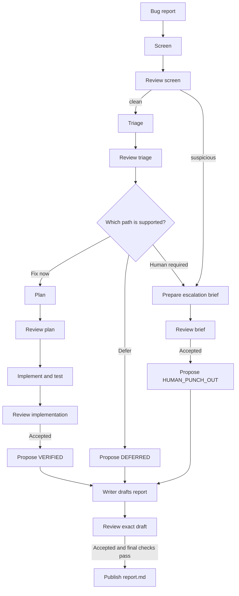
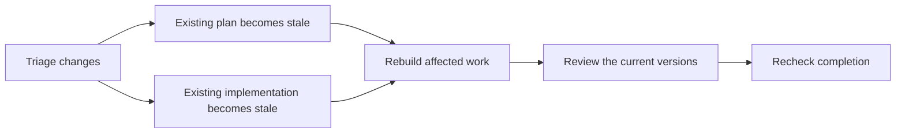

# Understanding Stage 5

This guide explains the codebase for someone joining the project. It describes the implementation as of **16 October 2026**, after the Step A, B and C hardening (a screen agent, a report handle for the coordinator, and test files created by the implementer).

## 1. What this project does

Stage 5 is a learning and certification project that uses several AI agents to handle a bug report. The agents investigate, plan, implement, review, and explain the result. When a decision needs a person, the workflow prepares a brief for that person.

The central rule is:

> The coordinator chooses what to do next. Python code checks whether the action and its result are allowed.

The coordinator cannot edit files or run tests itself. It can only launch one of seven helpers. Each helper gets a specific job and a limited set of tools. It never sees the raw bug report: it gets a handle (id, length, sha256 and a note that the report is untrusted data), and quoted report text is stripped from the screen, escalate and writer output it receives.

The project extends the Stage 4 bug-fix workflow. The original Stage 4 repository at `~/dev/rijo-stage4-2` is a read-only reference. This repository runs agents through the Fireworks API, using the OpenAI-compatible Python SDK.

## 2. The small application being fixed

The agents work on the example application in [sandbox/demo-app/](sandbox/demo-app/). Its requirements are written in [SPEC.md](sandbox/demo-app/SPEC.md).

Two bugs are deliberately present in the baseline:

- `calc.average([])` divides by zero, although the specification requires `0.0`.
- `storage.save_records()` opens and truncates the destination before serialization succeeds. A serialization failure can destroy the existing records.

The reports in [test-data/bugs/](test-data/bugs/) exercise four situations:

| Report | Expected outcome |
|---|---|
| Empty-list calculation bug | Fix and verify it. |
| The same calculation bug described as a regression | Restore the previous behavior and verify it. |
| Request to add `median()` | Defer it: no existing requirement calls for this feature. |
| Customer records lost during a failed save | Stop for a human decision. |

The sandbox bugs are test inputs. Finding them in the baseline does not mean the coordinator implementation is broken.

## 3. Who does what

[manifest.yaml](manifest.yaml) defines the models and tool permissions. [prompts/](prompts/) contains the instructions for each role.

| Role | Job | Tools |
|---|---|---|
| Coordinator | Choose the next helper and respond to its result. | Only `launch_*` tools |
| Screen | Read the untrusted report and rate it `clean` or `suspicious` (prompt injection or hostile instructions). It does not judge relevance. | None |
| Triage | Classify the report, identify a cause, and decide whether to fix, defer, or escalate. | `read_file` |
| Plan | Name the files to change, the edits, and the new test file or files (`test_files`). | `read_file` |
| Implement | Create the planned test file, apply the planned edits and run the test. | `read_file`, `edit_file`, `create_file`, `run_test` |
| Reviewer | Check another agent's work and return findings. | `read_file` |
| Escalate | Write a decision brief for a person. | None |
| Writer | Turn the run's evidence into readable report prose. | None |

The configured coordinator model is `accounts/fireworks/models/glm-5p3`. Helpers use `accounts/fireworks/models/deepseek-v4p1-flash`.

Every helper dispatch starts a new conversation with a system prompt and explicitly supplied inputs. It does not inherit another helper's conversation. This lets the reviewer inspect the work independently of the producer's private reasoning.

## 4. What happens during a run

A normal fix follows this path:



This diagram shows the main successful paths. Reviews can also send work back for revision or trigger escalation. A screen that is not `clean` sets "human required": triage, plan and implement are blocked, and the run can only end as `HUMAN_PUNCH_OUT`.

The reviewer returns one of three verdicts:

- `pass`: the work is accepted.
- `revise`: the producer should address the findings and submit a replacement.
- `escalate`: the problem needs a person.

Each producer, including the writer, can save an initial artifact and one replacement. A replacement also uses this allowance when an upstream change requires the producer to rebuild its work. Failed attempts do not consume the saved-artifact allowance.

The coordinator prompt tells it to retry an errored call once and escalate after another failure. The coordinator has at most **32 turns**; a helper conversation has at most **8 turns**. Only the first launch call in a coordinator turn executes.

A plain-text claim such as “done” cannot complete the run. After three refused completion claims, the run ends as `FAILED_COORDINATION`. Other explicit failure endings include `FAILED_TURN_BUDGET` and `FAILED_COORDINATOR_API`.

## 5. How Python controls the agents

The entry point is [harness/run.py](harness/run.py). It creates a run directory, copies the bug report, builds the coordinator, and records the final human disposition.

The [coordinator](harness/coordinator.py) sends launch requests through [LaunchRouter](harness/launch_router.py) to the [dispatcher](harness/dispatcher.py).

```mermaid
sequenceDiagram
    participant C as Coordinator model
    participant D as Python dispatcher
    participant H as Helper model
    participant T as Allowed tools
    participant S as Run files
    C->>D: Launch a helper
    D->>D: Check prerequisites and allowance
    alt Launch is allowed
        D->>H: Fresh conversation with explicit inputs
        loop Helper requests a permitted tool
            H->>T: Read, edit, or test
            T-->>H: Structured result
        end
        H-->>D: JSON output
        D->>D: Validate schema and role-specific rules
        D->>S: Save accepted artifact or rejected output; append audit
        D-->>C: Accepted artifact or structured error
    else Prerequisite is missing
        D->>S: Append rejected dispatch to audit
        D-->>C: Structured error without a helper API call
    end
```

An **artifact** is the JSON result of a helper's work. For example, a plan contains `files`, `steps`, and `test_files`. Artifact shapes are defined in [schemas/](schemas/).

[harness/agents.py](harness/agents.py) lists each role's prerequisites and checks. Important checks include:

- Triage needs a clean screen that has passed review. The screen also has a pattern backstop ([guardrails/screen_gate.py](guardrails/screen_gate.py)) that forces `suspicious` on known attack patterns; it catches known patterns only.
- A plan needs a reviewed, current triage that says `fix-now` without escalation. Its `test_files` must also be listed in `files`.
- Implementation needs a reviewed, current plan. Plan and implement are also blocked while a human is required.
- Output must be a JSON object matching the role's schema.
- Report text matching configured data-loss, security, or outage triggers forces triage escalation.
- Claimed edits and Git's observed sandbox changes must fit the plan's file list.
- A review must echo the expected target and hashes.

The coordinator receives accepted artifacts or an error containing `error_code` and `detail`. Rejected raw model output is kept separately for inspection.

## 6. Why old reviews cannot simply be reused

A **hash** is a fingerprint of content. The harness records which upstream artifact hashes a producer used. If those inputs change, its output becomes **stale**: it was built from an older version of the evidence.

Reviews bind to the target artifact's hash. Implementation reviews also bind to the current Git diff; writer reviews also bind to the rendered draft text.

For example:



[freshness.py](harness/freshness.py) checks these relationships. [terminal_state.py](harness/terminal_state.py) checks whether the proposed ending has enough current evidence.

Human-required reasons include historical escalation flags and dangerous findings. A later passing review does not erase an earlier dangerous finding.

## 7. How the final report is produced

The writer returns prose under section keys such as `overview`, `triage`, and `review`. Python determines the required sections and writes the headings, result line, and status labels.

Labels include `PASS`, `FAIL`, `UNREVIEWED`, `STALE`, and `NOT RUN`. An escalation section is labeled `AWAITING HUMAN`. A flagged screen is labeled `FLAGGED (review: <verdict>)`, with the quoted evidence in a code block.

The draft must pass its own review. Before publication, the harness checks that the draft still matches the current evidence and that the proposed terminal state is still legal. It then publishes the accepted draft unchanged as `report.md`.

If the coordinator ends through a handled failure path, Python writes a diagnostic failure report instead. That report identifies failed steps, human-required reasons, and any unaccepted writer drafts.

The main files are [report.py](harness/report.py), [report_builder.py](harness/report_builder.py), and [report_publisher.py](harness/report_publisher.py).

## 8. Execution result and human approval are separate

The **execution result** says what the automated run accomplished:

| Result | Meaning |
|---|---|
| `VERIFIED` | The required fix artifacts and reviews support completion. |
| `DEFERRED` | Reviewed triage decided to defer the report. |
| `HUMAN_PUNCH_OUT` | The run prepared a reviewed brief and report for a human decision. |
| `FAILED_*` | The automated workflow could not complete normally. |

The **human disposition** says whether required human decisions have been recorded:

| Disposition | Meaning |
|---|---|
| `REJECTED` | A required decision is reject. |
| `PENDING_HUMAN` | At least one required decision is missing. |
| `RELEASED` | All required decisions are continue. |
| `FINAL` | No human decision was required. |

There are two kinds of decision:

1. **Substance:** approval of the system's workflow-value assessment. The current [substance.json](substance.json) rates five workflows core (screen, triage, plan, implement, review) and two peripheral (escalate, writer), which requires this approval. It binds to the assessment and manifest hashes, so the earlier sign-off no longer matches after the screen and `create_file` changes; a new human sign-off is needed. Each run now also saves a write-once `substance-assessment.json` that `disposition.json` points at.
2. **Punch-out:** a decision about one stopped run. It binds to the run ID and final report hash.

Decisions are appended to `decisions/decisions.jsonl`. Only a human may sign them. The decision CLI is in [harness/decisions.py](harness/decisions.py); agents have no dedicated signing tool.

A human can release a failed report, but its execution result stays failed. Decisions do not resume runs or rewrite their reports. Further work starts a new run.

## 9. Where to look when following a run

Each run writes under `runs/<correlation-id>/`. The correlation ID identifies the run across its logs and artifacts.

```text
runs/<correlation-id>/
├── 00-report.md                 Copy of the incoming bug report
├── 01-triage.json               Accepted helper output
├── 01-triage.meta.json          Artifact hash and dependency metadata
├── 02-reviewer-triage.json      Review of that triage
├── ...                         Further numbered attempts
├── NN-writer.json              Writer's prose sections
├── NN-writer-draft.md           Rendered draft for review
├── rejected/                   Invalid model output, when available
├── audit.jsonl                 Structured dispatch and coordinator events
├── run.log                     Human-readable progress log
├── report.md                   Published report or failure report
└── disposition.json            Derived human-review status
```

The numbered files depend on the path taken. Failed dispatches also consume step numbers. Coordinator turns are audited separately and do not consume artifact numbers.

Start with `report.md` for the outcome, `run.log` for the sequence, and `audit.jsonl` for exact events, model IDs, token counts, and calculated costs.

## 10. What the tests and evaluations prove

There are three layers:

| Layer | How it works | What it checks |
|---|---|---|
| Local pytest suite | Fake LLM clients, temporary files, and scripted replies | Harness behavior, permissions, invalid output, stale reviews, reporting, and decisions |
| Helper and coordinator evaluations | Real helper calls, or a real coordinator with canned helper replies | Helper quality and coordinator routing behavior |
| Workflow evaluations | Real coordinator and real helpers | Complete runs over the four sample reports |

The evaluation providers reuse the real runtime wiring. [evals/criteria.py](evals/criteria.py) defines named checks, and [evals/run_trace.py](evals/run_trace.py) reads dispatch order from saved evidence.

Writer tone and unsupported-claim checks use an LLM judge. Heading checks are deterministic. Implementation helper evaluations independently replay the implementer's new test file on the original code in a fresh copy (it must fail) and run it after the edit (it must pass). Screen evaluations check attacks are flagged, benign and off-topic reports stay clean, and quoted evidence really comes from the report.

Observed after the Step C hardening:

- **709 local tests passed.**
- Live helper results: screen 14/14, screen red team 15/15 (12 attacks flagged, 3 benign reports clean), triage 6/6, plan 4/4, implement 3/3, review 10/10, writer 3/3.
- Coordinator suite: **8 of 8** cases. Workflow suite: **18 of 18** runs (6 cases, 3 repeats each), including two hostile-report cases that ended `HUMAN_PUNCH_OUT`.
- The 15 red-team cases were written by Claude Opus. promptfoo's own local generation gave only 1 usable case of 12.

These are results for the inspected version and saved evaluations, not a guarantee for future model calls. See [results/success_metrics.csv](results/success_metrics.csv) for the breakdown.

[scripts/build_evidence.py](scripts/build_evidence.py) aggregates evaluation results and deduplicates audit events. Costs are calculated from configured token prices, not measured bills. Its totals exclude the writer evaluation's LLM-judge calls.

## 11. Limits worth understanding

- **Test execution is narrowed but not a security boundary.** `run_test` runs only the plan's pytest files (1 to 3 existing `test_*.py` files under the sandbox) with a command the harness builds. The implementer creates its test file with `create_file`, which only creates new `test_*.py` files under the sandbox and never overwrites. But the model still writes the Python in that test file, and pytest executes it, so the test code can still touch files outside the sandbox.
- **Runtime test success is reported by the implementer.** The normal runtime uses the artifact's `test_passed` value and review. The independent red check (replay on the original code) happens in the implementation evaluation provider only.
- **Screening is not a guarantee.** The screen model can be fooled, and the pattern backstop catches known patterns only. Redaction for the coordinator removes exact quotes only (the screen's evidence word for word, and runs of 6 or more copied words); a paraphrase gets through, error detail strings are not redacted, and triage, plan and implement text is not redacted.
- **Some routing rules still depend on the model.** The prompt tells the coordinator to retry once and to follow the screen first. The harness enforces the important gates: the screen gate before triage, and the human-checkpoint block on plan and implement.
- **Scope validation happens after edits.** Rejecting an implementation artifact does not undo its filesystem changes. Later implementation attempts build on the existing working tree. Git comparisons use `HEAD` as the baseline.
- **Workflow evaluations reset the real sandbox.** They restore tracked files and clean untracked sandbox files before and after each run. Uncommitted sandbox work must not be left there when running that suite.
- **Review does not prove semantic truth.** Hashes establish which content was reviewed; the model still judges whether that content is correct.

## 12. Getting oriented in the repository

Read these files in order to follow the main implementation:

1. [manifest.yaml](manifest.yaml): roles, models, and tools.
2. [prompts/coordinator.md](prompts/coordinator.md): the workflow the coordinator is instructed to follow.
3. [harness/run.py](harness/run.py) and [coordinator_wiring.py](harness/coordinator_wiring.py): entry point and assembly.
4. [harness/coordinator.py](harness/coordinator.py): the outer decision loop.
5. [harness/dispatcher.py](harness/dispatcher.py) and [agents.py](harness/agents.py): helper execution and validation.
6. [harness/freshness.py](harness/freshness.py), [run_state.py](harness/run_state.py), and [terminal_state.py](harness/terminal_state.py): evidence and completion rules.
7. [tests/test_coordinator.py](tests/test_coordinator.py) and [test_governance.py](tests/test_governance.py): examples of valid runs and refused completion attempts.

The local test command uses no paid API calls:

```bash
.venv/bin/python -m pytest -q tests
```

A live run makes paid Fireworks calls and may edit the sandbox:

```bash
set -a
source .env
set +a
.venv/bin/python -m harness.run test-data/bugs/bug-clear.md
```

Keep `.env` untracked. Follow an active run with `tail -f runs/<correlation-id>/run.log`.

## 13. Current build stage

The authoritative build plan is `~/claude-plans/stage5-coordinator.md`. Steps **0–8** are complete, including the README and its criteria-to-evidence map. The hardening plan `~/claude-plans/stage5-fixes.md` (Steps A, B and C) is also built. The one open item is the human re-sign of the substance assessment, which only a person can do.

The existing documents under [punch-out/](punch-out/) still describe parts of the Stage 4 workflow and should not be used as instructions for the Stage 5 runtime.

Build work proceeds one numbered step at a time, with human review between steps.
